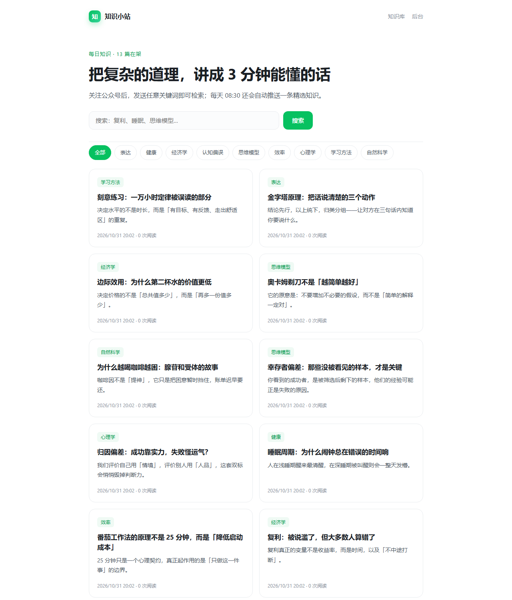
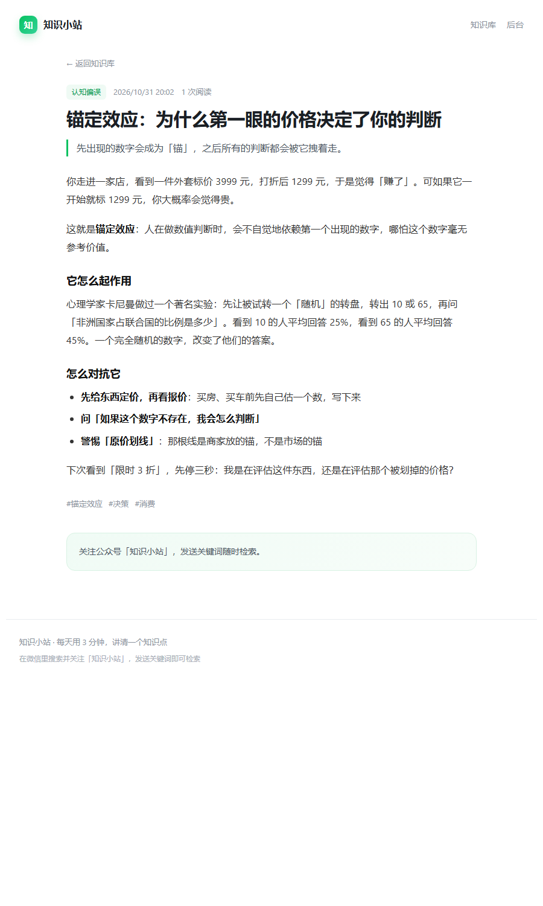
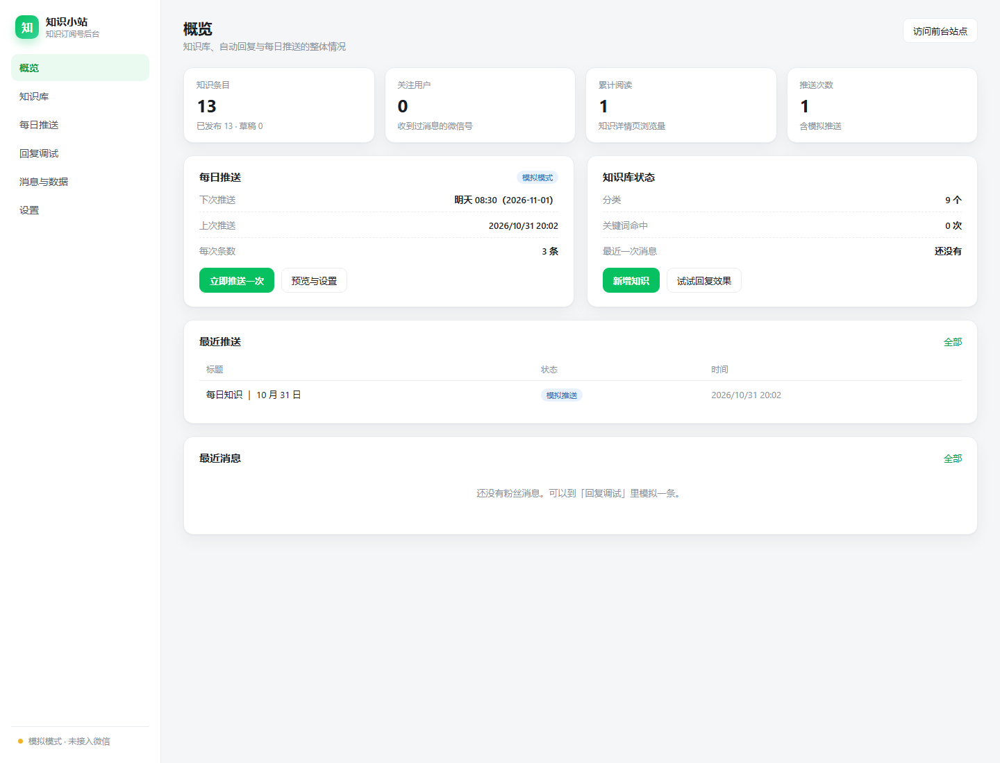
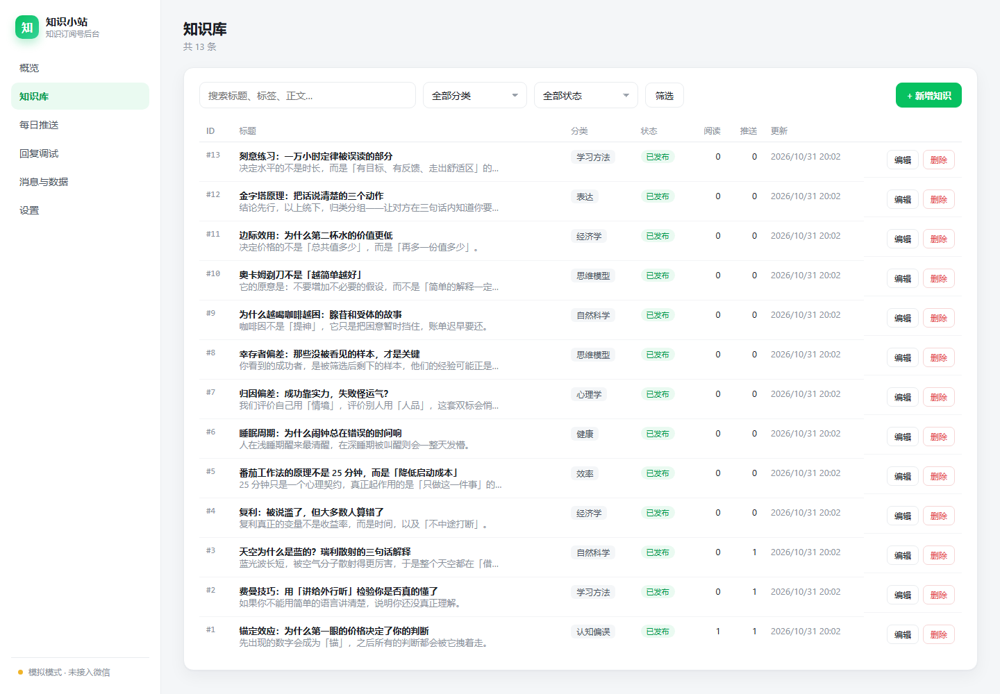
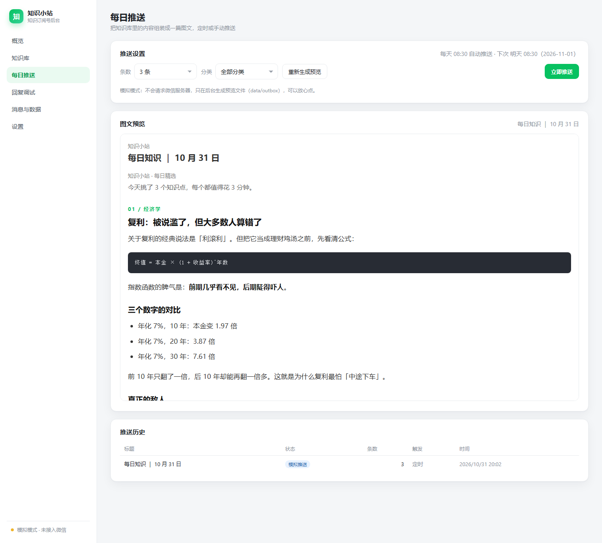
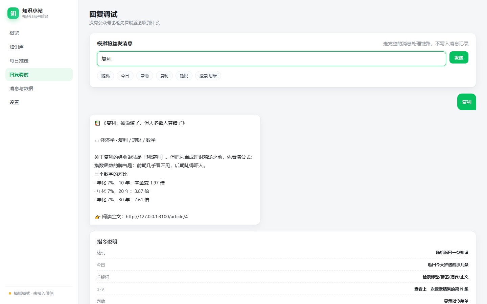

# 知识分享 · 微信订阅号程序

一个**零依赖**（不需要 `npm install`）的微信订阅号后台，专注「知识分享」这个场景：

- 📚 **知识库**：Markdown 写内容，分类 + 标签 + 摘要，支持草稿
- 💬 **关键词自动回复**：粉丝发「复利」就能收到对应卡片；支持「随机」「今日」、序号追问
- ⏰ **每日定时推送**：按设定时间把 N 条知识组装成一篇图文，写进公众号草稿箱
- 🔘 **自定义菜单 + 关注欢迎语**：一键同步菜单，新粉丝自动收到导览
- 🖥 **网页管理后台**：知识增删改、图文预览、推送历史、消息流水、关键词热度
- 🧪 **本地可演示**：默认「模拟模式」，没有公众号、没有服务器也能看到完整效果

技术栈只有 Node.js 内置模块：`node:http`、`node:crypto`、`node:fs`、`fetch`。数据存在一个 JSON 文件里，备份就是复制文件。

## 界面预览

| 前台知识库 | 知识详情 |
| --- | --- |
|  |  |

| 后台概览 | 知识库管理 |
| --- | --- |
|  |  |

| 每日推送预览 | 回复调试 |
| --- | --- |
|  |  |

---

## 快速开始

```bash
# 1. 需要 Node.js 20 及以上（本项目已在 24.x 上验证）
node -v

# 2. 可选：复制配置模板
cp .env.example .env      # Windows: copy .env.example .env

# 3. 启动
node src/index.js
# 或 npm start
```

打开：

| 地址 | 说明 |
| --- | --- |
| http://localhost:3000/ | 前台知识库（可以分享给粉丝的网页版） |
| http://localhost:3000/admin | 管理后台，初始密码 `admin123` |
| http://localhost:3000/wechat | 公众号服务器回调地址 |

首次启动会自动写入 13 条示例知识，直接就能在「回复调试」里看到效果。

> 第一次跑完记得改 `.env` 里的 `ADMIN_PASSWORD`。

### 不接公众号，先看效果

1. 进后台 → **回复调试**，输入 `随机`、`复利`、`今日`、`帮助`，右侧会显示粉丝实际收到的回复
2. 进 **每日推送** → 点「立即推送」，会生成一篇排版好的图文，可在页面里预览，同时落盘到 `data/outbox/`
3. 进 **知识库** → 新增/编辑，正文写 Markdown，点「刷新预览」看渲染结果

---

## 功能细节

### 粉丝侧（微信里）

| 发送内容 | 回复 |
| --- | --- |
| `随机` / `来一条` | 随机一条知识卡片（标题、分类、正文摘要、阅读链接） |
| `今日` | 今天推送的那几条 |
| `复利` / `睡眠` | 关键词检索，命中多条时返回编号列表 |
| `搜索 思维` | 强制走检索（避免某些词被当成指令） |
| `1` ~ `9` | 查看上一条搜索结果的第 N 条 |
| `帮助` / `?` | 指令菜单 |
| 首次关注 | 欢迎语 + 使用引导 |

检索会先做「所有词都命中」，没有结果时退化为「任一词命中」；排序考虑标题 > 标签 > 分类 > 摘要 > 正文。

### 管理后台

- **概览**：条目数、关注用户、累计阅读、推送次数、下次推送时间、最近消息
- **知识库**：搜索 / 分类 / 状态筛选；编辑器带 Markdown 实时预览（走服务端渲染，和推送时完全一致）
- **每日推送**：选择条数与分类 → 实时预览整篇图文 → 立即推送；带推送历史
- **回复调试**：模拟粉丝发消息，走完整链路（不写消息记录）
- **消息与数据**：关键词热度条形图 + 最近 300 条消息流水
- **设置**：运行模式、AppID/Secret/Token、推送时间与条数、接入步骤、接口调用记录、连通性测试

### 推送策略

`pickForPush()` 会优先挑「最久没推过」的条目，并让不同分类交替出现，避免连着几天推送同一主题。每推一次会记录 `lastPushedAt` / `pushCount`，所以内容会自然轮转。

定时器每 20 秒检查一次「今天是否已过推送时间」，用 `settings.lastPushDate` 做幂等：进程重启不会重复推送，推送失败也会记录当天已尝试，避免每 20 秒重试把接口打爆。

---

## 配置

配置优先级：`后台「设置」保存的值` > 环境变量 / `.env` > 默认值。

| 变量 | 默认 | 说明 |
| --- | --- | --- |
| `PORT` | `3000` | 监听端口 |
| `HOST` | `0.0.0.0` | 监听地址 |
| `ADMIN_PASSWORD` | `admin123` | 后台密码，**部署前必须改** |
| `PUBLIC_BASE_URL` | `http://localhost:3000` | 对外地址，用于生成知识链接 |
| `TZ_NAME` | `Asia/Shanghai` | 时区，决定推送时间按哪个时区算 |
| `WECHAT_MODE` | `mock` | `mock` 模拟 / `live` 真实 |
| `WECHAT_APPID` | 空 | 公众号 AppID |
| `WECHAT_SECRET` | 空 | 公众号 AppSecret |
| `WECHAT_TOKEN` | `knowledge` | 服务器配置里的 Token，两边必须一致 |
| `THUMB_MEDIA_ID` | 空 | 图文封面素材 media_id（真实模式必填） |
| `AUTO_PUBLISH` | `false` | 建草稿后是否立即提交发布（仅认证号） |
| `PUSH_TIME` | `08:30` | 每日推送时间 |
| `PUSH_COUNT` | `3` | 每次推送条数（1-8） |
| `ACCOUNT_NAME` | `知识小站` | 账号名，出现在图文署名与菜单 |
| `DATA_DIR` | `data` | 数据目录 |
| `SEED` | `on` | 设为 `off` 可跳过示例数据 |

---

## 接入真实公众号

**完整步骤（服务器、域名、Nginx、HTTPS、内网穿透、报错排查）见 [docs/deploy.md](docs/deploy.md)**，这里只给最短路径：

1. 程序跑在有公网 IP 的服务器上（80/443 可访问），`.env` 里 `PUBLIC_BASE_URL` 填真实域名
2. 本地自检：`npm run doctor https://你的域名`，三项全绿
3. 公众平台 → 设置与开发 → 基本配置 → **服务器配置**：URL 填 `https://你的域名/wechat`，Token 与 `WECHAT_TOKEN` 一致，EncodingAESKey 随机生成，加解密方式选**明文模式** → 提交 → **启用**
4. 认证号再补：`AppSecret`、**IP 白名单**、封面 `media_id`、切「真实模式」、点「测试连接」
5. 微信里发 `帮助` / `随机` 验证；图文去「每日推送」点一次，到草稿箱检查排版

### 几个平台限制（很重要）

- **个人主体订阅号无法微信认证**，因此没有群发、草稿箱、自定义菜单接口（调用返回 `48001`）。这类账号的玩法是：关键词回复全自动，图文用后台生成预览后手动发表。
- **订阅号每天只能群发 1 次**，所以「每日推送」设计成一天一次，且用日期幂等。
- **`freepublish/submit`（发布）只对已认证账号开放**；未认证账号只能把内容放进草稿箱，由你在公众平台手动发表。所以 `AUTO_PUBLISH` 默认 `false`。
- **`draft/add` 必须给 `thumb_media_id`**，否则会报 `45003` 之类的错误。
- **服务器配置的 URL 只支持 80 / 443 端口**，国内主机走 80/443 需要备案。
- 被动回复（粉丝发消息后的回复）必须在 **5 秒内**返回，本项目全部是本地计算，不会超时；真接大模型时要注意异步化。

---

## 目录结构

```
wechat-knowledge-share/
├─ src/
│  ├─ index.js            # 启动入口：配置、播种、监听、定时器
│  ├─ config.js           # .env 解析、配置合并、设置校验
│  ├─ server.js           # 极简路由 + 请求上下文 + 公众号回调
│  ├─ http.js             # 响应、Cookie、表单解析、静态文件
│  ├─ store.js            # JSON 存储（原子写入）
│  ├─ markdown.js         # Markdown → 微信行内样式 HTML
│  ├─ seed-data.js        # 13 条示例知识
│  ├─ wechat/
│  │  ├─ signature.js     # sha1 签名校验
│  │  ├─ xml.js           # 消息 XML 解析 / 构造
│  │  ├─ client.js        # access_token、草稿、发布、菜单、群发
│  │  └─ handler.js       # 消息分发总入口
│  ├─ services/
│  │  ├─ knowledge.js     # 检索、随机、轮转挑选、卡片文案
│  │  ├─ reply.js         # 指令解析与回复文案
│  │  ├─ publisher.js     # 图文组装、推送、预览落盘
│  │  └─ scheduler.js     # 每日定时推送
│  └─ web/
│     ├─ ui.js            # 后台页面
│     ├─ site.js         # 前台站点
│     └─ admin.js         # 后台路由与登录态
├─ public/                # 静态资源（无构建）
├─ scripts/doctor.mjs     # 接入自检：握手 + 回消息 + 凭证
├─ docs/deploy.md         # 部署与接公众号的完整步骤
├─ docs/screenshots/      # 界面截图
├─ test/smoke.test.js     # 13 个端到端测试
├─ data/                  # 运行时生成：db.json、outbox/
└─ Dockerfile
```

---

## 测试与自检

```bash
node --test "test/**/*.test.js"   # 端到端测试
npm run doctor                    # 检查 PUBLIC_BASE_URL 是否能完成公众号握手
npm run doctor https://你的域名     # 指定地址自检
```

`doctor` 会模拟微信服务器做三件事：探活、签名握手（回显 echostr）、发一条 `帮助` 看能不能拿到回复——相当于提前帮你在公众平台点了一次「提交」。测试覆盖：签名校验、关键词回复、随机回复、序号追问、文章页、后台鉴权、Markdown 预览转义、模拟推送落盘、XML 解析等。

---

## 部署

服务器 + 域名 + Nginx + HTTPS + systemd 的完整配置见 **[docs/deploy.md](docs/deploy.md)**。

最省事的两种跑法：

```bash
# 直接跑（建议用 systemd / pm2 / nssm 守护）
node src/index.js

# Docker
docker build -t knowledge-share .
docker run -d -p 3000:3000 -v $(pwd)/data:/app/data --env-file .env knowledge-share
```

---

## 数据与备份

- 全部数据在 `data/db.json`（知识、消息、推送记录、设置覆盖项）
- 推送预览 HTML 在 `data/outbox/`，可以直接用浏览器打开检查排版
- 备份：复制 `data/` 目录即可；恢复：放回去重启
- 想换成 MySQL / SQLite：只需要按 `src/store.js` 暴露的方法实现一遍（`findKnowledge`、`createKnowledge`、`recordMessage` 等）

---

## 常见问题

**Q：后台密码忘了？**
改 `.env` 的 `ADMIN_PASSWORD` 后重启。

**Q：改了设置没生效？**
后台设置存在 `data/db.json` 的 `configOverrides`，优先级高于 `.env`。想回到 `.env` 的值，把该字段清空保存即可（或删掉 `configOverrides` 里对应的键）。

**Q：真实模式下推送报 `40001` / `40164`？**
`40001` 是 access_token 失效（代码会自动重取一次）；`40164` 是 IP 不在白名单，去公众平台把服务器出口 IP 加进去。

**Q：为什么草稿箱里没有图？**
需要在素材库上传封面并把 `media_id` 填到设置里。

**Q：能用安全模式（AES 加密）吗？**
当前只实现明文模式。要上安全模式，需要补 `msg_signature` 校验与 AES-256-CBC 解密（`EncodingAESKey` + PKCS#7），改动集中在 `src/wechat/`。

**Q：可以接大模型自动写知识吗？**
可以。在 `src/services/publisher.js` 里组装图文之前插入一步生成逻辑即可；注意被动回复 5 秒超时，长任务要走「先回一句 + 异步客服消息」。

---

## 还可以怎么扩展

- 图片消息 / 语音消息的识别与转写
- 知识条目的「相关推荐」（按标签共现）
- 阅读量回流：把 `/article/:id` 的访问统计做成趋势图
- 多账号：给 `Store` 加 `accountId` 维度，配置按账号隔离
- 内容审核：推送前跑一遍敏感词检查

---

MIT License
